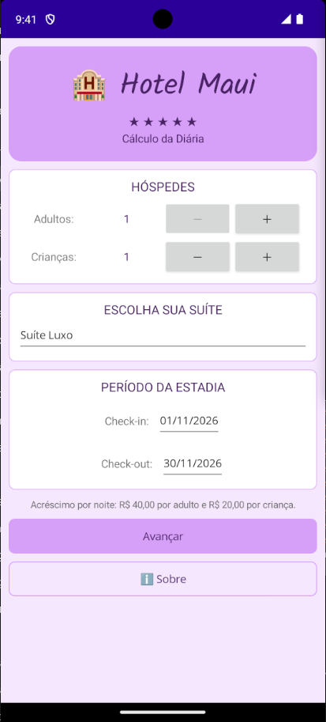
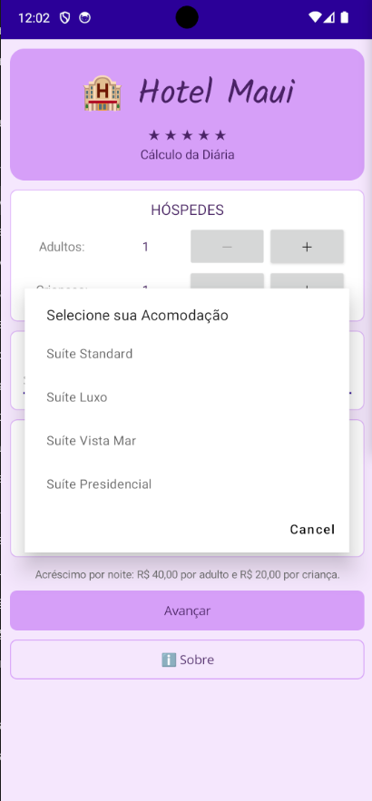
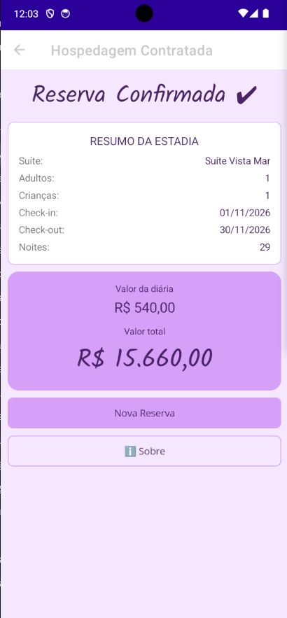

# 🏨 MauiAppHotel

Aplicativo mobile desenvolvido em **.NET MAUI** para calcular o valor de uma hospedagem em hotel. O usuário escolhe a suíte, informa a quantidade de hóspedes e o período da estadia, e o app mostra o resumo da reserva com o valor total.

Projeto da disciplina **Desenvolvimento de Sistemas II**, com layout temático de hotel e uma tela **Sobre**.

## ✨ Funcionalidades

- Escolha da suíte entre quatro opções
- Seleção de quantidade de adultos e crianças
- Seleção das datas de check-in e check-out, com validação (o check-out precisa ser depois do check-in)
- Resumo da hospedagem: suíte, hóspedes, datas, número de diárias, valor da diária e **valor total**
- Botão para fazer uma nova reserva
- Tela **Sobre**, com informações do aplicativo, nome da desenvolvedora e ano de desenvolvimento

## 📱 Telas

| Tela | Descrição |
|------|-----------|
| Contratação de Hospedagem | Escolha da suíte, hóspedes e datas |
| Hospedagem Contratada | Resumo da reserva e valor total |
| Sobre | Informações do app, desenvolvedora e ano |

## 💰 Como o valor é calculado

| Suíte | Diária base |
|-------|------------:|
| Standard | R$ 220,00 |
| Luxo | R$ 340,00 |
| Vista Mar | R$ 480,00 |
| Presidencial | R$ 750,00 |

Sobre a diária base, são somados acréscimos **por pessoa, por noite**:

- Adulto: + R$ 40,00
- Criança: + R$ 20,00

```
Valor da diária = diária da suíte + (adultos × 40) + (crianças × 20)
Valor total     = valor da diária × número de noites
```

## 🛠️ Tecnologias

- [.NET 8](https://dotnet.microsoft.com/)
- .NET MAUI (C# e XAML)
- Padrão de navegação com `Shell` e `NavigationPage`

## 📂 Estrutura do projeto

```
MauiAppHotel/
├── Models/
│   ├── Quarto.cs              # Descrição e valor da diária
│   └── Hospedagem.cs          # Regras de cálculo da hospedagem
├── Views/
│   ├── ContratacaoHospedagem.xaml(.cs)
│   ├── HospedagemContratada.xaml(.cs)
│   └── Sobre.xaml(.cs)
├── Resources/                 # Fontes, imagens, cores e estilos
├── Platforms/                 # Código específico de cada plataforma
└── MauiAppHotel.csproj
```

## ▶️ Como executar

### No Windows (Visual Studio 2022)

1. Instale o Visual Studio 2022 com a carga de trabalho **Desenvolvimento para dispositivos móveis com .NET (MAUI)**.
2. Abra o arquivo `MauiAppHotel.sln`.
3. Escolha o destino (emulador Android ou Windows Machine) e pressione **F5**.

### No Linux (somente Android)

Requisitos: .NET 8 SDK, JDK 17, workload `maui-android` e Android SDK.

```bash
dotnet workload install maui-android
```

No Linux, o `.csproj` precisa ter apenas o alvo Android. Em `TargetFrameworks`, deixe:

```xml
<TargetFrameworks>net8.0-android</TargetFrameworks>
```

Com um emulador ou celular conectado (`adb devices`), execute dentro da pasta `MauiAppHotel`:

```bash
dotnet build -t:Run -f net8.0-android \
  -p:AndroidSdkDirectory=$HOME/Android/Sdk \
  -p:JavaSdkDirectory=$JAVA_HOME
```

## 🖼️ Capturas de tela

| Tela inicial | Escolha da suíte |
|:---:|:---:|
|  |  |

| Reserva confirmada | Tela Sobre |
|:---:|:---:|
|  |  |

## 👩‍💻 Desenvolvedora

**Adrielle Maciel de Sena** — 2026
